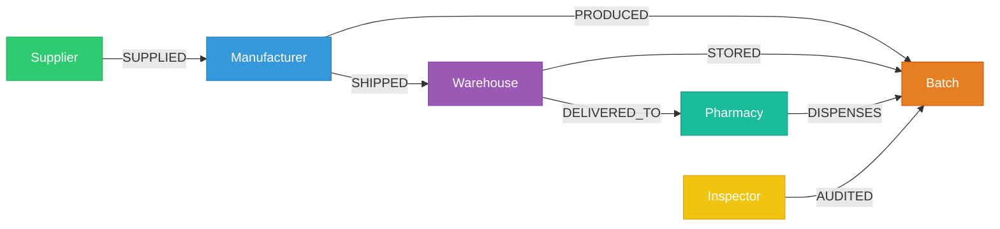

# PharmaTrack: Pharmaceutical Supply Chain & Counterfeit Detection Graph Database

[](https://neo4j.com)
[](https://python.org)
[](https://flask.palletsprojects.com)
[](LICENSE)

An enterprise-grade Graph Database project developed for the **Advanced Database Laboratory (DJS23OLOE503)**. Built on **Neo4j AuraDB** and **Cypher**, PharmaTrack models multi-tier pharmaceutical supply chains to provide instant $O(1)$ batch provenance tracing, temperature telemetry audits, and automated counterfeit drug detection.

---

## 📑 Table of Contents
- [Project Overview](#-project-overview)
- [Why Graph Databases over Relational SQL?](#-why-graph-databases-over-relational-sql)
- [Graph Schema Architecture](#-graph-schema-architecture)
- [Project Structure](#-project-structure)
- [Quick Start Guide](#-quick-start-guide)
- [Cypher CRUD Query Reference](#-cypher-crud-query-reference)
- [Academic Manual Alignment](#-academic-manual-alignment)

---

## 🔬 Project Overview

In pharmaceutical distribution, ensuring drug safety requires tracking medications from active ingredient suppliers through manufacturing facilities, wholesale depots, and dispensing pharmacies. Counterfeit medications and cold-chain temperature violations represent major public health risks.

**PharmaTrack** utilizes property graphs to solve two critical challenges:
1. **End-to-End Batch Lineage ($O(1)$ Traversal):** Instantly traces the origin of any medicine blister pack back through all intermediate custody handoffs.
2. **Counterfeit Isolation:** Identifies suspicious stock sold at pharmacies that lacks verified factory manufacturing links.
3. **Cold-Chain Telemetry Auditing:** Verifies transit temperatures along shipping routes to prevent spoiled temperature-sensitive medications (e.g., Insulin).

---

## ⚡ Why Graph Databases over Relational SQL?

| Capability | Relational DBMS (SQL) | Graph DBMS (Neo4j / Cypher) |
| :--- | :--- | :--- |
| **Multi-Hop Traversal** | Deep nested `JOIN`s or recursive CTEs; degrades exponentially ($O(n^k)$). | Native index-free adjacency; executes in constant $O(1)$ time per hop. |
| **Trace Query Complexity** | 40+ lines of SQL across 6 tables with foreign keys. | Single pattern-match line: `(s)-[:SUPPLIED]->(m)-[:PRODUCED]->(b)`. |
| **Anomaly & Counterfeit Detection** | Complex `LEFT OUTER JOIN` with `IS NULL` filters. | Intuitive graph negation: `WHERE NOT (:Manufacturer)-[:PRODUCED]->(b)`. |
| **Schema Flexibility** | Adding temperature telemetry requires `ALTER TABLE` migrations. | Edge properties can be added dynamically on relationships. |

---

## 📐 Graph Schema Architecture

### Node Labels (Entities)
- `Supplier`: Raw chemical and API providers (`id`, `name`, `country`, `certified`).
- `Manufacturer`: Licensed pharmaceutical factories (`id`, `name`, `city`, `gmpCompliant`).
- `Batch`: Production drug lot (`batchId`, `drugName`, `mfgDate`, `expiryDate`, `status`).
- `Warehouse`: Climate-controlled regional logistics hubs (`id`, `name`, `city`, `coldChainSupported`).
- `Pharmacy`: Retail pharmacies and hospital dispensaries (`id`, `name`, `licenseNo`, `city`).
- `Inspector`: Regulatory bodies performing audits (`id`, `name`, `agency`).

### Relationships (Edges)
- `(:Supplier)-[:SUPPLIED {ingredient, date, lotNo}]->(:Manufacturer)`
- `(:Manufacturer)-[:PRODUCED {date, totalUnits}]->(:Batch)`
- `(:Manufacturer)-[:SHIPPED {dispatchDate, carrier, tempCelsius}]->(:Warehouse)`
- `(:Warehouse)-[:STORED {shelfZone, entryDate}]->(:Batch)`
- `(:Warehouse)-[:DELIVERED_TO {deliveryDate, qtyReceived}]->(:Pharmacy)`
- `(:Pharmacy)-[:DISPENSES]->(:Batch)`
- `(:Inspector)-[:AUDITED {auditDate, outcome, certNo}]->(:Batch)`



---

## 📁 Project Structure

```text
pharmatrack-neo4j/
│
├── 2026-27 ADB Exp 10 Manual.docx   # Completed Mini Project - I Report (Design & Schema)
├── 2026-27 ADB Exp 11 Manual.docx   # Completed Mini Project - II Report (CRUD & Queries)
│
├── app.py                           # Flask Web Server & Neo4j Aura API
├── templates/
│   └── index.html                   # Interactive Vis.js Graph Dashboard
├── static/
│   ├── style.css                    # Modern UI styles
│   └── script.js                    # Graph physics, query triggers & inspector
│
├── diagrams/
│   ├── graph_schema.png             # Formal Graph Schema visual architecture
│   ├── full_graph_network.png       # Live seeded graph cluster visualization
│   └── provenance_trace.png         # Query 1 visual traversal path
│
├── seed_database.cypher             # Raw Cypher script for manual execution
├── generate_diagrams.py             # Matplotlib script to recreate visual diagrams
├── build_manuals.py                 # Script that formats and populates the .docx files
├── requirements.txt                 # Dependencies: flask, neo4j, python-dotenv
├── .env                             # Live Neo4j Aura connection credentials
├── .env.example                     # Environment template
└── README.md                        # Documentation
```

---

## 🚀 Quick Start Guide

### 1. Clone the Repository
```bash
git clone https://github.com/HarshSingh8472/pharmatrack-neo4j.git
cd pharmatrack-neo4j
```

### 2. Install Dependencies
```bash
pip install -r requirements.txt
```

### 3. Configure Credentials
The `.env` file is pre-configured with the live **Neo4j AuraDB** cloud instance. To point to your own instance, update `.env`:
```env
NEO4J_URI=neo4j+s://<YOUR_INSTANCE_ID>.databases.neo4j.io
NEO4J_USERNAME=<YOUR_USERNAME>
NEO4J_PASSWORD=<YOUR_PASSWORD>
NEO4J_DATABASE=neo4j
PORT=5000
```

### 4. Run the Web Dashboard
```bash
python app.py
```
Open your browser at: **`http://localhost:5000`**

---

## 💻 Cypher CRUD Query Reference

### 1. CREATE: Constraints & Graph Seeding
```cypher
// Ensure uniqueness
CREATE CONSTRAINT IF NOT EXISTS FOR (b:Batch) REQUIRE b.batchId IS UNIQUE;
CREATE CONSTRAINT IF NOT EXISTS FOR (s:Supplier) REQUIRE s.id IS UNIQUE;

// Seed Core Nodes
CREATE (s1:Supplier {id: 'SUP-01', name: 'Apex BioChem Ltd', country: 'Germany', certified: true})
CREATE (m1:Manufacturer {id: 'MFG-01', name: 'PharmaCore Labs', city: 'Basel', gmpCompliant: true})
CREATE (b1:Batch {batchId: 'BATCH-2026-A1', drugName: 'Amoxicillin 500mg', mfgDate: '2026-03-10', expiryDate: '2028-03-10', status: 'ACTIVE'})
CREATE (w1:Warehouse {id: 'WH-CENTRAL', name: 'Euro Hub Logistics', city: 'Frankfurt', coldChainSupported: true})
CREATE (p1:Pharmacy {id: 'PHARM-01', name: 'City Central Pharmacy', city: 'Frankfurt', licenseNo: 'LIC-8821'})

// Connect Custody Lineage
CREATE (s1)-[:SUPPLIED {ingredient: 'Active Amoxicillin Powder', date: '2026-02-15'}]->(m1)
CREATE (m1)-[:PRODUCED {date: '2026-03-10', totalUnits: 50000}]->(b1)
CREATE (m1)-[:SHIPPED {dispatchDate: '2026-03-14', carrier: 'DHL Pharma', tempCelsius: 4.5}]->(w1)
CREATE (w1)-[:STORED {shelfZone: 'Cold-A2', entryDate: '2026-03-15'}]->(b1)
CREATE (w1)-[:DELIVERED_TO {deliveryDate: '2026-03-20', qtyReceived: 5000}]->(p1)
CREATE (p1)-[:DISPENSES]->(b1);
```

### 2. READ: Query 1 — End-to-End Batch Provenance Trace
```cypher
MATCH (s:Supplier)-[:SUPPLIED]->(m:Manufacturer)-[:PRODUCED]->(b:Batch {batchId: 'BATCH-2026-A1'})<-[:STORED]-(w:Warehouse)-[:DELIVERED_TO]->(p:Pharmacy)
RETURN s.name AS Supplier, m.name AS Manufacturer, b.drugName AS Drug, 
       w.name AS Warehouse, p.name AS Pharmacy;
```

### 3. READ: Query 2 — Counterfeit & Broken Chain Detection
```cypher
MATCH (p:Pharmacy)-[:DISPENSES]->(b:Batch)
WHERE NOT (:Manufacturer)-[:PRODUCED]->(b)
RETURN p.name AS SuspiciousPharmacy, b.batchId AS SuspiciousBatch, 
       b.drugName AS DrugName, b.status AS CurrentStatus;
```

### 4. READ: Query 3 — Cold-Chain Logistics Audit
```cypher
MATCH (m:Manufacturer)-[s:SHIPPED]->(w:Warehouse)-[:STORED]->(b:Batch {drugName: 'Insulin Glargine'})
RETURN b.batchId AS Batch, m.name AS Manufacturer, w.name AS Warehouse, 
       s.carrier AS Carrier, s.tempCelsius AS TransitTemp;
```

### 5. UPDATE: Query 4 — Batch Quarantine & Recall Mutation
```cypher
MATCH (b:Batch {batchId: 'BATCH-FAKE-X9'})
SET b.status = 'QUARANTINED_COUNTERFEIT', b.flaggedDate = '2026-10-28'
RETURN b.batchId AS Batch, b.status AS UpdatedStatus, b.flaggedDate AS FlagDate;
```

### 6. DELETE: Query 5 — Rogue Supplier Connection Removal
```cypher
MATCH (s:Supplier {id: 'SUP-03'})-[r:SUPPLIED]->()
DELETE r
RETURN count(r) AS DeletedRelationships;
```

---

## 🎓 Academic Manual Alignment

Both official laboratory experiment manuals are generated inside this directory:
- **`2026-27 ADB Exp 10 Manual.docx` (Mini Project - I)**
  - Problem Statement
  - Objectives
  - Graph Schema & Entity/Relationship Tables
  - High-Resolution Architecture Schema Diagram
- **`2026-27 ADB Exp 11 Manual.docx` (Mini Project - II)**
  - Cypher CRUD Queries (Formatted Code Blocks)
  - Output Screenshots & Tabular Execution Records
  - Performance & Traversal Observations
  - Technical Conclusion

